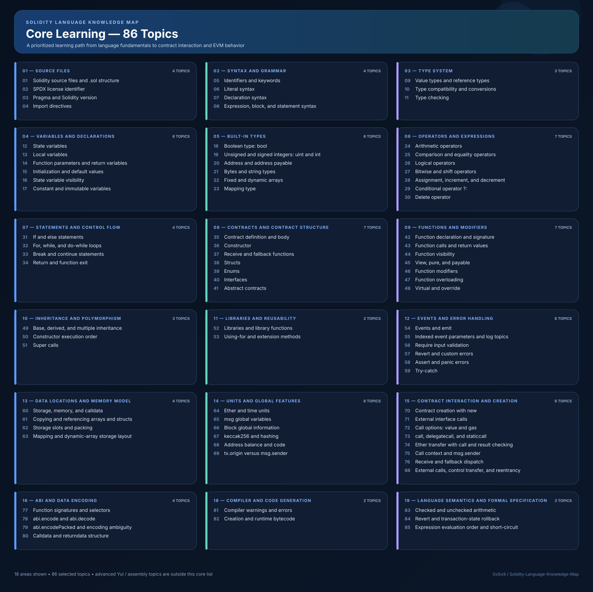

# Solidity Core Learning Map — 86 Topics

A focused learning path containing **86 selected core Solidity topics**, grouped into their relevant subject folders. This README and its diagram cover the core list only.

> **Scope note:** This is a curated learning-priority map, not an official 86-item Solidity specification. Advanced topics such as standalone Yul and inline assembly are intentionally outside this core list.

## Visual map

## Learn Solidity alongside blockchain concepts

The **86 numbered Solidity topics remain the primary learning order**. The Blockchain Concepts roadmap is a support reference: study only the EVM, ABI, storage, architecture, transaction, or RPC concepts that help with the Solidity topic you are working on. **Do not wait to complete all six blockchain stages before starting Solidity.**

📚 **Companion prerequisite repository:** [Blockchain Concepts Learning Roadmap — open the repository containing the six relevant stages](https://github.com/0xSix9/Blockchain-Concepts-Learning-Roadmap). You can also [open the concepts directory and browse the stages](https://github.com/0xSix9/Blockchain-Concepts-Learning-Roadmap/tree/main/concepts).

➡️ **[Open the complete Solidity ↔ Blockchain Concepts Prerequisite Map](BLOCKCHAIN-PREREQUISITE-MAP.md)** — includes a topic-by-topic table for all 86 items, readiness labels, **direct links to the exact prerequisite articles** in the six-stage blockchain concepts repository, and recommended checkpoints.

### How to read the prerequisite map

- **None** — no blockchain-specific prerequisite is needed to learn the Solidity feature.
- **Familiarity** — understand the basic mechanism; a deep dive can wait.
- **Required before deep study** — learn the linked concepts before expecting to explain the feature's runtime behavior confidently. You can still study its Solidity syntax earlier.
- **Study alongside / revisit** — useful context or a later deepening point, not a blocker.

### Key learning checkpoints

The links in the last column open the relevant stage inside the [Blockchain Concepts Learning Roadmap](https://github.com/0xSix9/Blockchain-Concepts-Learning-Roadmap), which contains the six stages used by this guide.

| Solidity topics | Focus | Blockchain concepts to prioritize |
|---|---|---|
| **1–34** | Solidity language foundations | Start coding; no blockchain prerequisite for most topics. Optional reference: the [six-stage Blockchain Concepts roadmap](https://github.com/0xSix9/Blockchain-Concepts-Learning-Roadmap). |
| **35–59** | Contracts, functions, inheritance, events, and errors | Use [Stage 01 — EVM Execution](https://github.com/0xSix9/Blockchain-Concepts-Learning-Roadmap/tree/main/concepts/01-evm-execution), [Stage 02 — ABI and Contract Interaction](https://github.com/0xSix9/Blockchain-Concepts-Learning-Roadmap/tree/main/concepts/02-abi-contract-interaction), and selected [Stage 04 — Smart Contract Architecture](https://github.com/0xSix9/Blockchain-Concepts-Learning-Roadmap/tree/main/concepts/04-smart-contract-architecture) concepts as needed. |
| **60–63** | Storage, Memory, Calldata, and data layout | **Deep study:** [Stage 01 — EVM Execution](https://github.com/0xSix9/Blockchain-Concepts-Learning-Roadmap/tree/main/concepts/01-evm-execution) + [Stage 03 — Storage and Data Layout](https://github.com/0xSix9/Blockchain-Concepts-Learning-Roadmap/tree/main/concepts/03-storage-data-layout). |
| **64–76** | Global values, hashing, deployment, and contract calls | Prioritize [Stage 01 — EVM Execution](https://github.com/0xSix9/Blockchain-Concepts-Learning-Roadmap/tree/main/concepts/01-evm-execution) and [Stage 02 — ABI and Contract Interaction](https://github.com/0xSix9/Blockchain-Concepts-Learning-Roadmap/tree/main/concepts/02-abi-contract-interaction); add [Stage 03 — Storage and Data Layout](https://github.com/0xSix9/Blockchain-Concepts-Learning-Roadmap/tree/main/concepts/03-storage-data-layout), [Stage 04 — Smart Contract Architecture](https://github.com/0xSix9/Blockchain-Concepts-Learning-Roadmap/tree/main/concepts/04-smart-contract-architecture), and [Stage 05 — Advanced Transactions and Gas](https://github.com/0xSix9/Blockchain-Concepts-Learning-Roadmap/tree/main/concepts/05-advanced-transactions-gas) where relevant. |
| **77–80** | Function selectors and ABI encoding | **Deep study:** [Stage 02 — ABI and Contract Interaction](https://github.com/0xSix9/Blockchain-Concepts-Learning-Roadmap/tree/main/concepts/02-abi-contract-interaction), plus calldata/returndata concepts in [Stage 01 — EVM Execution](https://github.com/0xSix9/Blockchain-Concepts-Learning-Roadmap/tree/main/concepts/01-evm-execution) and [Stage 03 — Storage and Data Layout](https://github.com/0xSix9/Blockchain-Concepts-Learning-Roadmap/tree/main/concepts/03-storage-data-layout). |
| **81–85** | Compiler, bytecode, arithmetic, rollback, and language semantics | Focus on Solidity/compiler behavior; use [Stage 01 — EVM Execution](https://github.com/0xSix9/Blockchain-Concepts-Learning-Roadmap/tree/main/concepts/01-evm-execution) and [Stage 05 — Advanced Transactions and Gas](https://github.com/0xSix9/Blockchain-Concepts-Learning-Roadmap/tree/main/concepts/05-advanced-transactions-gas) to explain runtime effects. |
| **86** | External calls and reentrancy | **Integration checkpoint:** [Stage 01 — EVM Execution](https://github.com/0xSix9/Blockchain-Concepts-Learning-Roadmap/tree/main/concepts/01-evm-execution) + [Stage 02 — ABI and Contract Interaction](https://github.com/0xSix9/Blockchain-Concepts-Learning-Roadmap/tree/main/concepts/02-abi-contract-interaction) + [Stage 03 — Storage and Data Layout](https://github.com/0xSix9/Blockchain-Concepts-Learning-Roadmap/tree/main/concepts/03-storage-data-layout) + [Stage 04 — Smart Contract Architecture](https://github.com/0xSix9/Blockchain-Concepts-Learning-Roadmap/tree/main/concepts/04-smart-contract-architecture). Add [Stage 05 — Advanced Transactions and Gas](https://github.com/0xSix9/Blockchain-Concepts-Learning-Roadmap/tree/main/concepts/05-advanced-transactions-gas) for Gas and failed-transaction context. |

**Application connectivity is learned when it becomes useful.** You do not need to finish JSON-RPC, transaction signing, or node concepts before writing Solidity. Prioritize [Stage 06 — Application Connectivity](https://github.com/0xSix9/Blockchain-Concepts-Learning-Roadmap/tree/main/concepts/06-application-connectivity) when you begin connecting a website or another external application to your contracts.

---

## Core topic files

### 01 — Source Files

[Open folder](https://github.com/0xSix9/Solidity-Language-Knowledge-Map/tree/main/01-source-files)

- ✅ [`01-solidity-source-files.md`](https://github.com/0xSix9/Solidity-Language-Knowledge-Map/blob/main/01-source-files/01-solidity-source-files.md)
- ✅ [`02-spdx-license-identifier.md`](https://github.com/0xSix9/Solidity-Language-Knowledge-Map/blob/main/01-source-files/02-spdx-license-identifier.md)
- ✅ [`03-pragma-and-solidity-version.md`](https://github.com/0xSix9/Solidity-Language-Knowledge-Map/blob/main/01-source-files/03-pragma-and-solidity-version.md)
- ✅ [`04-import-directives.md`](https://github.com/0xSix9/Solidity-Language-Knowledge-Map/blob/main/01-source-files/04-import-directives.md)

### 02 — Syntax and Grammar

[Open folder](https://github.com/0xSix9/Solidity-Language-Knowledge-Map/tree/main/02-syntax-and-grammar)

- [`05-identifiers-and-keywords.md`](https://github.com/0xSix9/Solidity-Language-Knowledge-Map/blob/main/02-syntax-and-grammar/05-identifiers-and-keywords.md)
- [`06-literal-syntax.md`](https://github.com/0xSix9/Solidity-Language-Knowledge-Map/blob/main/02-syntax-and-grammar/06-literal-syntax.md)
- [`07-declaration-syntax.md`](https://github.com/0xSix9/Solidity-Language-Knowledge-Map/blob/main/02-syntax-and-grammar/07-declaration-syntax.md)
- [`08-expression-block-and-statement-syntax.md`](https://github.com/0xSix9/Solidity-Language-Knowledge-Map/blob/main/02-syntax-and-grammar/08-expression-block-and-statement-syntax.md)

### 03 — Type System

[Open folder](https://github.com/0xSix9/Solidity-Language-Knowledge-Map/tree/main/03-type-system)

- [`09-value-types-and-reference-types.md`](https://github.com/0xSix9/Solidity-Language-Knowledge-Map/blob/main/03-type-system/09-value-types-and-reference-types.md)
- [`10-type-compatibility-and-conversions.md`](https://github.com/0xSix9/Solidity-Language-Knowledge-Map/blob/main/03-type-system/10-type-compatibility-and-conversions.md)
- [`11-type-checking.md`](https://github.com/0xSix9/Solidity-Language-Knowledge-Map/blob/main/03-type-system/11-type-checking.md)

### 04 — Variables and Declarations

[Open folder](https://github.com/0xSix9/Solidity-Language-Knowledge-Map/tree/main/04-variables-and-declarations)

- [`12-state-variables.md`](https://github.com/0xSix9/Solidity-Language-Knowledge-Map/blob/main/04-variables-and-declarations/12-state-variables.md)
- [`13-local-variables.md`](https://github.com/0xSix9/Solidity-Language-Knowledge-Map/blob/main/04-variables-and-declarations/13-local-variables.md)
- [`14-function-parameters-and-return-variables.md`](https://github.com/0xSix9/Solidity-Language-Knowledge-Map/blob/main/04-variables-and-declarations/14-function-parameters-and-return-variables.md)
- [`15-initialization-and-default-values.md`](https://github.com/0xSix9/Solidity-Language-Knowledge-Map/blob/main/04-variables-and-declarations/15-initialization-and-default-values.md)
- [`16-state-variable-visibility.md`](https://github.com/0xSix9/Solidity-Language-Knowledge-Map/blob/main/04-variables-and-declarations/16-state-variable-visibility.md)
- [`17-constant-and-immutable-variables.md`](https://github.com/0xSix9/Solidity-Language-Knowledge-Map/blob/main/04-variables-and-declarations/17-constant-and-immutable-variables.md)

### 05 — Built-in Types

[Open folder](https://github.com/0xSix9/Solidity-Language-Knowledge-Map/tree/main/05-built-in-types)

- [`18-bool-type.md`](https://github.com/0xSix9/Solidity-Language-Knowledge-Map/blob/main/05-built-in-types/18-bool-type.md)
- [`19-uint-and-int-types.md`](https://github.com/0xSix9/Solidity-Language-Knowledge-Map/blob/main/05-built-in-types/19-uint-and-int-types.md)
- [`20-address-and-address-payable.md`](https://github.com/0xSix9/Solidity-Language-Knowledge-Map/blob/main/05-built-in-types/20-address-and-address-payable.md)
- [`21-bytes-and-string-types.md`](https://github.com/0xSix9/Solidity-Language-Knowledge-Map/blob/main/05-built-in-types/21-bytes-and-string-types.md)
- [`22-fixed-and-dynamic-arrays.md`](https://github.com/0xSix9/Solidity-Language-Knowledge-Map/blob/main/05-built-in-types/22-fixed-and-dynamic-arrays.md)
- [`23-mapping-type.md`](https://github.com/0xSix9/Solidity-Language-Knowledge-Map/blob/main/05-built-in-types/23-mapping-type.md)

### 06 — Operators and Expressions

[Open folder](https://github.com/0xSix9/Solidity-Language-Knowledge-Map/tree/main/06-operators-and-expressions)

- [`24-arithmetic-operators.md`](https://github.com/0xSix9/Solidity-Language-Knowledge-Map/blob/main/06-operators-and-expressions/24-arithmetic-operators.md)
- [`25-comparison-and-equality-operators.md`](https://github.com/0xSix9/Solidity-Language-Knowledge-Map/blob/main/06-operators-and-expressions/25-comparison-and-equality-operators.md)
- [`26-logical-operators.md`](https://github.com/0xSix9/Solidity-Language-Knowledge-Map/blob/main/06-operators-and-expressions/26-logical-operators.md)
- [`27-bitwise-and-shift-operators.md`](https://github.com/0xSix9/Solidity-Language-Knowledge-Map/blob/main/06-operators-and-expressions/27-bitwise-and-shift-operators.md)
- [`28-assignment-increment-and-decrement.md`](https://github.com/0xSix9/Solidity-Language-Knowledge-Map/blob/main/06-operators-and-expressions/28-assignment-increment-and-decrement.md)
- [`29-conditional-operator.md`](https://github.com/0xSix9/Solidity-Language-Knowledge-Map/blob/main/06-operators-and-expressions/29-conditional-operator.md)
- [`30-delete-operator.md`](https://github.com/0xSix9/Solidity-Language-Knowledge-Map/blob/main/06-operators-and-expressions/30-delete-operator.md)

### 07 — Statements and Control Flow

[Open folder](https://github.com/0xSix9/Solidity-Language-Knowledge-Map/tree/main/07-statements-and-control-flow)

- [`31-if-and-else-statements.md`](https://github.com/0xSix9/Solidity-Language-Knowledge-Map/blob/main/07-statements-and-control-flow/31-if-and-else-statements.md)
- [`32-for-while-and-do-while-loops.md`](https://github.com/0xSix9/Solidity-Language-Knowledge-Map/blob/main/07-statements-and-control-flow/32-for-while-and-do-while-loops.md)
- [`33-break-and-continue-statements.md`](https://github.com/0xSix9/Solidity-Language-Knowledge-Map/blob/main/07-statements-and-control-flow/33-break-and-continue-statements.md)
- [`34-return-and-function-exit.md`](https://github.com/0xSix9/Solidity-Language-Knowledge-Map/blob/main/07-statements-and-control-flow/34-return-and-function-exit.md)

### 08 — Contracts and Contract Structure

[Open folder](https://github.com/0xSix9/Solidity-Language-Knowledge-Map/tree/main/08-contracts-and-contract-structure)

- [`35-contract-definition-and-body.md`](https://github.com/0xSix9/Solidity-Language-Knowledge-Map/blob/main/08-contracts-and-contract-structure/35-contract-definition-and-body.md)
- [`36-constructor.md`](https://github.com/0xSix9/Solidity-Language-Knowledge-Map/blob/main/08-contracts-and-contract-structure/36-constructor.md)
- [`37-receive-and-fallback-functions.md`](https://github.com/0xSix9/Solidity-Language-Knowledge-Map/blob/main/08-contracts-and-contract-structure/37-receive-and-fallback-functions.md)
- [`38-structs.md`](https://github.com/0xSix9/Solidity-Language-Knowledge-Map/blob/main/08-contracts-and-contract-structure/38-structs.md)
- [`39-enums.md`](https://github.com/0xSix9/Solidity-Language-Knowledge-Map/blob/main/08-contracts-and-contract-structure/39-enums.md)
- [`40-interfaces.md`](https://github.com/0xSix9/Solidity-Language-Knowledge-Map/blob/main/08-contracts-and-contract-structure/40-interfaces.md)
- [`41-abstract-contracts.md`](https://github.com/0xSix9/Solidity-Language-Knowledge-Map/blob/main/08-contracts-and-contract-structure/41-abstract-contracts.md)

### 09 — Functions and Modifiers

[Open folder](https://github.com/0xSix9/Solidity-Language-Knowledge-Map/tree/main/09-functions-and-modifiers)

- [`42-function-declaration-and-signature.md`](https://github.com/0xSix9/Solidity-Language-Knowledge-Map/blob/main/09-functions-and-modifiers/42-function-declaration-and-signature.md)
- [`43-function-calls-and-return-values.md`](https://github.com/0xSix9/Solidity-Language-Knowledge-Map/blob/main/09-functions-and-modifiers/43-function-calls-and-return-values.md)
- [`44-function-visibility.md`](https://github.com/0xSix9/Solidity-Language-Knowledge-Map/blob/main/09-functions-and-modifiers/44-function-visibility.md)
- [`45-view-pure-and-payable.md`](https://github.com/0xSix9/Solidity-Language-Knowledge-Map/blob/main/09-functions-and-modifiers/45-view-pure-and-payable.md)
- [`46-function-modifiers.md`](https://github.com/0xSix9/Solidity-Language-Knowledge-Map/blob/main/09-functions-and-modifiers/46-function-modifiers.md)
- [`47-function-overloading.md`](https://github.com/0xSix9/Solidity-Language-Knowledge-Map/blob/main/09-functions-and-modifiers/47-function-overloading.md)
- [`48-virtual-and-override.md`](https://github.com/0xSix9/Solidity-Language-Knowledge-Map/blob/main/09-functions-and-modifiers/48-virtual-and-override.md)

### 10 — Inheritance and Polymorphism

[Open folder](https://github.com/0xSix9/Solidity-Language-Knowledge-Map/tree/main/10-inheritance-and-polymorphism)

- [`49-base-derived-and-multiple-inheritance.md`](https://github.com/0xSix9/Solidity-Language-Knowledge-Map/blob/main/10-inheritance-and-polymorphism/49-base-derived-and-multiple-inheritance.md)
- [`50-constructor-execution-order.md`](https://github.com/0xSix9/Solidity-Language-Knowledge-Map/blob/main/10-inheritance-and-polymorphism/50-constructor-execution-order.md)
- [`51-super-calls.md`](https://github.com/0xSix9/Solidity-Language-Knowledge-Map/blob/main/10-inheritance-and-polymorphism/51-super-calls.md)

### 11 — Libraries and Reusability

[Open folder](https://github.com/0xSix9/Solidity-Language-Knowledge-Map/tree/main/11-libraries-and-reusability)

- [`52-libraries-and-library-functions.md`](https://github.com/0xSix9/Solidity-Language-Knowledge-Map/blob/main/11-libraries-and-reusability/52-libraries-and-library-functions.md)
- [`53-using-for-and-extension-methods.md`](https://github.com/0xSix9/Solidity-Language-Knowledge-Map/blob/main/11-libraries-and-reusability/53-using-for-and-extension-methods.md)

### 12 — Events and Error Handling

[Open folder](https://github.com/0xSix9/Solidity-Language-Knowledge-Map/tree/main/12-events-and-error-handling)

- [`54-events-and-emit.md`](https://github.com/0xSix9/Solidity-Language-Knowledge-Map/blob/main/12-events-and-error-handling/54-events-and-emit.md)
- [`55-indexed-event-parameters-and-log-topics.md`](https://github.com/0xSix9/Solidity-Language-Knowledge-Map/blob/main/12-events-and-error-handling/55-indexed-event-parameters-and-log-topics.md)
- [`56-require-input-validation.md`](https://github.com/0xSix9/Solidity-Language-Knowledge-Map/blob/main/12-events-and-error-handling/56-require-input-validation.md)
- [`57-revert-and-custom-errors.md`](https://github.com/0xSix9/Solidity-Language-Knowledge-Map/blob/main/12-events-and-error-handling/57-revert-and-custom-errors.md)
- [`58-assert-and-panic-errors.md`](https://github.com/0xSix9/Solidity-Language-Knowledge-Map/blob/main/12-events-and-error-handling/58-assert-and-panic-errors.md)
- [`59-try-catch.md`](https://github.com/0xSix9/Solidity-Language-Knowledge-Map/blob/main/12-events-and-error-handling/59-try-catch.md)

### 13 — Data Locations and Memory Model

[Open folder](https://github.com/0xSix9/Solidity-Language-Knowledge-Map/tree/main/13-data-locations-and-memory-model)

- [`60-storage-memory-and-calldata.md`](https://github.com/0xSix9/Solidity-Language-Knowledge-Map/blob/main/13-data-locations-and-memory-model/60-storage-memory-and-calldata.md)
- [`61-copying-and-referencing-arrays-and-structs.md`](https://github.com/0xSix9/Solidity-Language-Knowledge-Map/blob/main/13-data-locations-and-memory-model/61-copying-and-referencing-arrays-and-structs.md)
- [`62-storage-slots-and-packing.md`](https://github.com/0xSix9/Solidity-Language-Knowledge-Map/blob/main/13-data-locations-and-memory-model/62-storage-slots-and-packing.md)
- [`63-mapping-and-dynamic-array-storage-layout.md`](https://github.com/0xSix9/Solidity-Language-Knowledge-Map/blob/main/13-data-locations-and-memory-model/63-mapping-and-dynamic-array-storage-layout.md)

### 14 — Units and Global Features

[Open folder](https://github.com/0xSix9/Solidity-Language-Knowledge-Map/tree/main/14-units-and-global-features)

- [`64-ether-and-time-units.md`](https://github.com/0xSix9/Solidity-Language-Knowledge-Map/blob/main/14-units-and-global-features/64-ether-and-time-units.md)
- [`65-msg-global-variables.md`](https://github.com/0xSix9/Solidity-Language-Knowledge-Map/blob/main/14-units-and-global-features/65-msg-global-variables.md)
- [`66-block-global-information.md`](https://github.com/0xSix9/Solidity-Language-Knowledge-Map/blob/main/14-units-and-global-features/66-block-global-information.md)
- [`67-keccak256-and-hashing.md`](https://github.com/0xSix9/Solidity-Language-Knowledge-Map/blob/main/14-units-and-global-features/67-keccak256-and-hashing.md)
- [`68-address-balance-and-code.md`](https://github.com/0xSix9/Solidity-Language-Knowledge-Map/blob/main/14-units-and-global-features/68-address-balance-and-code.md)
- [`69-tx-origin-vs-msg-sender.md`](https://github.com/0xSix9/Solidity-Language-Knowledge-Map/blob/main/14-units-and-global-features/69-tx-origin-vs-msg-sender.md)

### 15 — Contract Interaction and Creation

[Open folder](https://github.com/0xSix9/Solidity-Language-Knowledge-Map/tree/main/15-contract-interaction-and-creation)

- [`70-contract-creation-with-new.md`](https://github.com/0xSix9/Solidity-Language-Knowledge-Map/blob/main/15-contract-interaction-and-creation/70-contract-creation-with-new.md)
- [`71-external-interface-calls.md`](https://github.com/0xSix9/Solidity-Language-Knowledge-Map/blob/main/15-contract-interaction-and-creation/71-external-interface-calls.md)
- [`72-call-options-value-and-gas.md`](https://github.com/0xSix9/Solidity-Language-Knowledge-Map/blob/main/15-contract-interaction-and-creation/72-call-options-value-and-gas.md)
- [`73-call-delegatecall-and-staticcall.md`](https://github.com/0xSix9/Solidity-Language-Knowledge-Map/blob/main/15-contract-interaction-and-creation/73-call-delegatecall-and-staticcall.md)
- [`74-ether-transfer-with-call-and-result-checking.md`](https://github.com/0xSix9/Solidity-Language-Knowledge-Map/blob/main/15-contract-interaction-and-creation/74-ether-transfer-with-call-and-result-checking.md)
- [`75-call-context-and-msg-sender.md`](https://github.com/0xSix9/Solidity-Language-Knowledge-Map/blob/main/15-contract-interaction-and-creation/75-call-context-and-msg-sender.md)
- [`76-receive-and-fallback-dispatch.md`](https://github.com/0xSix9/Solidity-Language-Knowledge-Map/blob/main/15-contract-interaction-and-creation/76-receive-and-fallback-dispatch.md)
- [`86-external-calls-control-transfer-and-reentrancy.md`](https://github.com/0xSix9/Solidity-Language-Knowledge-Map/blob/main/15-contract-interaction-and-creation/86-external-calls-control-transfer-and-reentrancy.md)

### 16 — ABI and Data Encoding

[Open folder](https://github.com/0xSix9/Solidity-Language-Knowledge-Map/tree/main/16-abi-and-data-encoding)

- [`77-function-signatures-and-selectors.md`](https://github.com/0xSix9/Solidity-Language-Knowledge-Map/blob/main/16-abi-and-data-encoding/77-function-signatures-and-selectors.md)
- [`78-abi-encode-and-decode.md`](https://github.com/0xSix9/Solidity-Language-Knowledge-Map/blob/main/16-abi-and-data-encoding/78-abi-encode-and-decode.md)
- [`79-abi-encodepacked-and-encoding-ambiguity.md`](https://github.com/0xSix9/Solidity-Language-Knowledge-Map/blob/main/16-abi-and-data-encoding/79-abi-encodepacked-and-encoding-ambiguity.md)
- [`80-calldata-and-returndata-structure.md`](https://github.com/0xSix9/Solidity-Language-Knowledge-Map/blob/main/16-abi-and-data-encoding/80-calldata-and-returndata-structure.md)

### 18 — Compiler and Code Generation

[Open folder](https://github.com/0xSix9/Solidity-Language-Knowledge-Map/tree/main/18-compiler-and-code-generation)

- [`81-compiler-warnings-and-errors.md`](https://github.com/0xSix9/Solidity-Language-Knowledge-Map/blob/main/18-compiler-and-code-generation/81-compiler-warnings-and-errors.md)
- [`82-creation-and-runtime-bytecode.md`](https://github.com/0xSix9/Solidity-Language-Knowledge-Map/blob/main/18-compiler-and-code-generation/82-creation-and-runtime-bytecode.md)

### 19 — Language Semantics and Formal Specification

[Open folder](https://github.com/0xSix9/Solidity-Language-Knowledge-Map/tree/main/19-language-semantics-and-formal-specification)

- [`83-checked-and-unchecked-arithmetic.md`](https://github.com/0xSix9/Solidity-Language-Knowledge-Map/blob/main/19-language-semantics-and-formal-specification/83-checked-and-unchecked-arithmetic.md)
- [`84-revert-and-transaction-state-rollback.md`](https://github.com/0xSix9/Solidity-Language-Knowledge-Map/blob/main/19-language-semantics-and-formal-specification/84-revert-and-transaction-state-rollback.md)
- [`85-expression-evaluation-order-and-short-circuit.md`](https://github.com/0xSix9/Solidity-Language-Knowledge-Map/blob/main/19-language-semantics-and-formal-specification/85-expression-evaluation-order-and-short-circuit.md)

## How to use this map

1. Study the topics in sequence, using the numbered filenames as a checklist.
2. For each topic, learn the concept, write a small example, and test both expected and failing behavior.
3. Keep each topic file focused on one subject at a time.
4. Add more advanced Solidity and EVM topics after the core concepts are understood.
